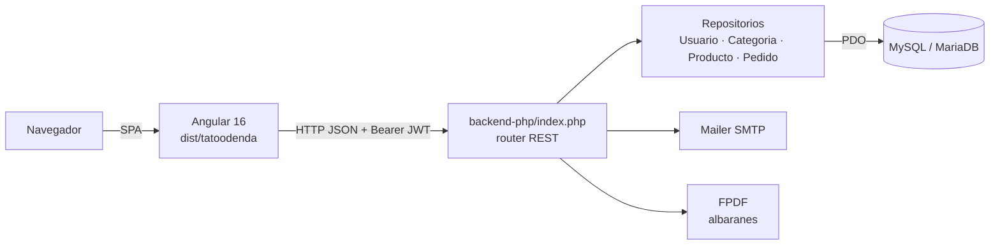
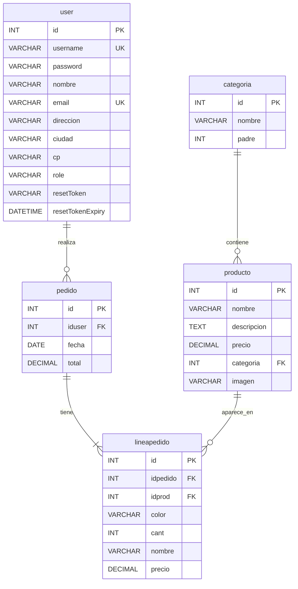
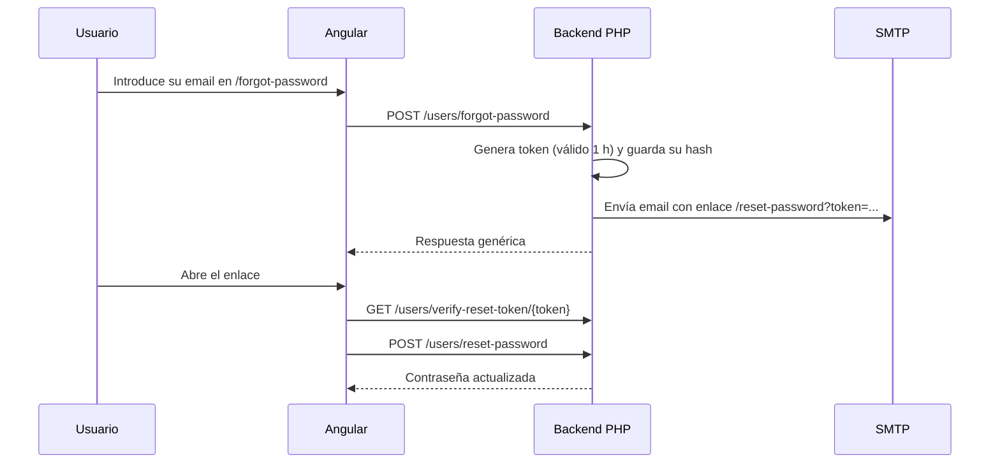

# TatooDenda Simply 🛍️

Tienda online de **piercing y dilatadores** desarrollada con **Angular 16** en el frontend y un **backend PHP sin dependencias** (sin Composer) sobre **MySQL/MariaDB**.

Es la versión *simplificada* de TatooDenda: un único backend PHP sustituye al backend original en Node/Express/Sequelize, de forma que todo el proyecto se puede desplegar en un hosting compartido (p. ej. Arsys) subiendo los ficheros por FTP.

> Proyecto con finalidad didáctica, pensado para los ciclos de Desarrollo de Aplicaciones Web (DAW).

---

## Índice

1. [Características](#características)
2. [Stack tecnológico](#stack-tecnológico)
3. [Arquitectura](#arquitectura)
4. [Estructura del proyecto](#estructura-del-proyecto)
5. [Requisitos](#requisitos)
6. [Instalación en local](#instalación-en-local)
7. [Configuración](#configuración)
8. [API REST](#api-rest)
9. [Modelo de datos](#modelo-de-datos)
10. [Rutas del frontend](#rutas-del-frontend)
11. [Autenticación y roles](#autenticación-y-roles)
12. [Recuperación de contraseña](#recuperación-de-contraseña)
13. [Albaranes en PDF y correo](#albaranes-en-pdf-y-correo)
14. [Imágenes de productos](#imágenes-de-productos)
15. [Scripts auxiliares](#scripts-auxiliares)
16. [Despliegue en producción](#despliegue-en-producción)
17. [Checklist de seguridad](#checklist-de-seguridad)
18. [Limitaciones conocidas y pendientes](#limitaciones-conocidas-y-pendientes)
19. [Licencia](#licencia)
20. [Autor](#autor)

---

## Características

### Para el cliente

- Catálogo de productos con listado general, filtrado por categoría y vista **“Ver todo”**.
- **Ficha de producto** y vista rápida en *popup*, con selección de **color/acabado** (la imagen cambia según el color elegido).
- **Buscador** de productos por texto.
- **Carrito** persistente en el navegador (`localStorage`).
- **Registro e inicio de sesión** mediante ventanas emergentes (no hay páginas `/login` ni `/register`; esas rutas redirigen al inicio).
- **Checkout** protegido: solo usuarios autenticados pueden confirmar pedidos.
- **Perfil de usuario** editable (datos personales, dirección y contraseña con modal de confirmación).
- **Historial de pedidos** con sus líneas.
- **Albarán en PDF** del pedido (generado en el navegador con jsPDF y/o en el servidor con FPDF) y envío por correo.
- **Recuperación de contraseña** por email con enlace de un solo uso y caducidad de 1 hora.
- Alertas y confirmaciones con **SweetAlert2**.

### Para el administrador

- El backend expone operaciones de **alta, edición y borrado** de categorías y productos restringidas al rol `admin`.
- En el frontend existen los componentes `AdminComponent`, `CategoryManagerComponent` y `ProductManagerComponent`, además de `AdminGuard` (ver [pendientes](#limitaciones-conocidas-y-pendientes)).

### Backend

- *Front controller* único (`index.php`) con enrutado REST tolerante a la ausencia de `mod_rewrite`.
- **JWT HS256** implementado en PHP nativo (`hash_hmac`), sin librerías externas.
- Contraseñas con **bcrypt** (`password_hash` / `password_verify`).
- Acceso a datos con **PDO** y consultas preparadas.
- **Cliente SMTP propio** con sockets nativos (STARTTLS 587 / SSL 465, `AUTH LOGIN`, adjuntos).
- Generación de PDF en servidor con **FPDF** (fichero único, incluido en `backend-php/lib/`).
- Configuración en dos capas: `config.php` (valores de desarrollo) + `config.local.php` (valores reales, fuera de Git).

---

## Stack tecnológico

| Capa | Tecnología |
|---|---|
| Frontend | Angular 16.2 (módulos, no *standalone*), TypeScript 5, RxJS 7.8, SCSS |
| UI | Bootstrap 5.3, SweetAlert2 |
| PDF (cliente) | jsPDF 2.5 |
| Backend | PHP nativo (sin Composer), PDO |
| PDF (servidor) | FPDF |
| Base de datos | MySQL / MariaDB (InnoDB, `utf8mb4`) |
| Servidor web | Apache con `mod_rewrite` (`.htaccess` incluido) |
| Entorno local de referencia | MAMP (MySQL en el puerto 8889) |

---

## Arquitectura



El frontend añade a `environment.apiUrl` los recursos `/users`, `/categorias`, `/productos` y `/pedidos`. El backend acepta también un prefijo opcional `/api/`.

---

## Estructura del proyecto

```text
tatoodenda-simply/
├── backend-php/                 # API REST en PHP (se sube tal cual al hosting)
│   ├── .htaccess                # Reescritura a index.php + paso de la cabecera Authorization
│   ├── index.php                # Front controller / router
│   ├── config.php               # Configuración base (desarrollo)
│   ├── config.local.php         # (NO versionado) valores reales de producción
│   ├── db.php                   # Conexión PDO
│   ├── helpers.php              # Response, body_json(), Jwt, require_auth(), require_admin()
│   ├── usuarios.php             # UsuarioRepo (registro, login, perfil, reset de contraseña)
│   ├── categorias.php           # CategoriaRepo
│   ├── productos.php            # ProductoRepo
│   ├── pedidos.php              # PedidoRepo (pedidos + líneas)
│   ├── mailer.php               # Cliente SMTP sin dependencias
│   ├── albaran.php              # Generación del albarán con FPDF
│   ├── google.php               # Verificación de id_token de Google (no enrutado aún)
│   ├── lib/                     # FPDF + fuentes
│   └── sql/
│       ├── tatoodenda.sql                   # Esquema + datos de ejemplo
│       └── migracion_reset_password.sql     # Migración para BBDD antiguas
├── src/
│   ├── app/
│   │   ├── components/          # admin, banner, cart, checkout, forgot-password,
│   │   │                        # historial-pedidos, home, login-popup, orderline,
│   │   │                        # password-confirm-modal, product/*, registro-popup,
│   │   │                        # reset-password, shared/(header|navbar|footer), user/profile
│   │   ├── guards/              # auth.guard.ts, admin.guard.ts
│   │   ├── helpers/             # product-image-helper.ts
│   │   ├── interceptors/        # auth, jwt, error
│   │   ├── models/              # category, order, orderline, product, user
│   │   ├── pipes/               # image-url.pipe.ts
│   │   ├── services/            # auth, cart, category, image, login-popup, order, pdf, product
│   │   ├── app-routing.module.ts
│   │   └── app.module.ts
│   ├── assets/images/           # Imágenes organizadas por familia/tipo/modelo/color
│   ├── environments/            # environment.ts / environment.prod.ts
│   └── styles.scss
├── agregar.sh                   # Utilidades de reorganización de imágenes (ver más abajo)
├── check_code_paths.sh
├── reorganize_images.sh
├── update_get_image_path.sh
├── angular.json
├── package.json
└── tsconfig*.json
```

---

## Requisitos

- **Node.js** compatible con Angular 16 (Angular 16 admite Node `^16.14.0` o `^18.10.0`) y **npm**.
- **Angular CLI 16** (se instala como dependencia de desarrollo; también puede usarse con `npx ng`).
- **PHP 7 o superior** con la extensión `pdo_mysql` (el código usa `??`, `random_bytes()` y `declare(strict_types=1)`; el repositorio no fija una versión mínima concreta).
- **MySQL o MariaDB** con soporte `utf8mb4`.
- **Apache** con `mod_rewrite` (recomendado; el router también funciona con `index.php?path=...`).

> Angular 16 usa por defecto el *builder* de webpack, por lo que compila sin problemas en macOS antiguos donde `esbuild` (Angular 17+) da incompatibilidades.

---

## Instalación en local

### 1. Clonar el repositorio

```bash
git clone https://github.com/jsersan/tatoodenda-simply.git
cd tatoodenda-simply
```

### 2. Crear la base de datos

Con phpMyAdmin (*Importar* → `backend-php/sql/tatoodenda.sql`) o por terminal. Ejemplo con MAMP:

```bash
/Applications/MAMP/Library/bin/mysql -u root -p -h 127.0.0.1 -P 8889 \
  < backend-php/sql/tatoodenda.sql
```

El script crea la base de datos `tatoodenda`, las tablas y unos datos de ejemplo, incluido un usuario administrador:

| Usuario | Contraseña | Rol |
|---|---|---|
| `admin` | `admin123` | `admin` |

> ⚠️ Cambia esta contraseña tras el primer inicio de sesión.

Si ya tenías la tabla `user` creada de una versión anterior (sin las columnas de recuperación de contraseña), ejecuta además `backend-php/sql/migracion_reset_password.sql`.

### 3. Arrancar el backend PHP

Sirve la carpeta `backend-php/` con el Apache de MAMP (por ejemplo, copiándola o enlazándola dentro de `htdocs`) o con el servidor embebido de PHP para pruebas rápidas:

```bash
cd backend-php
php -S localhost:8000 index.php
```

Comprueba que responde:

```bash
curl http://localhost:8000/health
curl http://localhost:8000/info
```

### 4. Configurar y arrancar el frontend

Edita `src/environments/environment.ts` para que `apiUrl` apunte a tu backend local (ver [Configuración](#configuración)) y después:

```bash
npm install
npm start          # equivale a ng serve → http://localhost:4200
```

---

## Configuración

### Backend: `config.php` + `config.local.php`

`config.php` contiene los valores por defecto y **se versiona**. Si existe `backend-php/config.local.php`, sus valores se fusionan encima (`array_replace_recursive`). Ese fichero está en `.gitignore` y es donde deben ir **todos los secretos reales**.

Ejemplo de `backend-php/config.local.php` (valores de ejemplo, sustitúyelos):

```php
<?php
return [
    'db' => [
        'host'    => 'TU_HOST_MYSQL',
        'port'    => '3306',
        'name'    => 'TU_BASE_DE_DATOS',
        'user'    => 'TU_USUARIO',
        'pass'    => 'TU_CONTRASEÑA',
        'charset' => 'utf8mb4',
    ],
    'jwt_secret'   => 'una-cadena-larga-y-aleatoria',
    'jwt_ttl'      => 60 * 60 * 24,              // 24 h
    'app_url'      => 'https://tu-dominio/ruta-del-frontend',
    'dev_mode'     => false,
    'smtp' => [
        'host'      => 'smtp.tu-dominio.com',
        'port'      => 587,                      // 587 STARTTLS · 465 SSL
        'secure'    => 'tls',                    // 'tls' · 'ssl' · ''
        'user'      => 'usuario-smtp',
        'pass'      => 'contraseña-smtp',
        'from'      => 'no-reply@tu-dominio.com',
        'from_name' => 'TatooDenda',
        'timeout'   => 15,
    ],
    'cors_origins' => ['https://tu-dominio'],
];
```

| Clave | Descripción |
|---|---|
| `db.*` | Conexión PDO a MySQL/MariaDB. MAMP usa el puerto `8889`; la mayoría de servidores, `3306`. |
| `jwt_secret` | Clave de firma de los tokens. **Obligatorio cambiarla** en producción. |
| `jwt_ttl` | Vida del token en segundos (por defecto 24 h). |
| `app_url` | URL pública del frontend; se usa para construir el enlace de recuperación de contraseña. |
| `dev_mode` | Si es `true` (o si `smtp.host` está vacío), `/users/forgot-password` devuelve el enlace de reset en la respuesta para poder probar sin correo. |
| `smtp.*` | Envío de correo. Con `host` vacío no se envía nada. |
| `cors_origins` | Orígenes permitidos (además, `index.php` incluye su propia lista para `localhost:4200` y `txemaserrano.com`). |

### Frontend: `src/environments/`

```ts
export const environment = {
  production: false,
  apiUrl: 'http://localhost:8000',   // URL base del backend PHP (sin barra final)
  googleClientId: ''                 // vacío = no se muestra el botón de Google
};
```

`environment.prod.ts` se usa automáticamente en `ng build` (configuración `production`, mediante `fileReplacements`).

---

## API REST

Todas las respuestas son JSON. Las rutas marcadas con 🔒 requieren cabecera `Authorization: Bearer <token>`; las marcadas con 🛡️ requieren además rol `admin`.

### Usuarios — `/users`

| Método | Ruta | Acceso | Descripción |
|---|---|---|---|
| `POST` | `/users/register` | Público | Registro. Devuelve el usuario y su `token`. |
| `POST` | `/users/login` | Público | Login con `{ username, password }`. Devuelve el usuario y su `token`. |
| `GET` | `/users/profile` | 🔒 | Perfil del usuario del token. |
| `PUT` | `/users/{id}` | 🔒 | Actualiza `username`, `nombre`, `email`, `direccion`, `ciudad`, `cp` y, opcionalmente, `password`. |
| `POST` | `/users/forgot-password` | Público | `{ email }`. Respuesta genérica (no revela si el email existe). |
| `GET` | `/users/verify-reset-token/{token}` | Público | Indica si un token de recuperación es válido. |
| `POST` | `/users/reset-password` | Público | `{ token, newPassword }`. |

### Categorías — `/categorias`

| Método | Ruta | Acceso | Descripción |
|---|---|---|---|
| `GET` | `/categorias` | Público | Lista de categorías. |
| `GET` | `/categorias/{id}` | Público | Una categoría. |
| `POST` | `/categorias` | 🛡️ | Crear. |
| `PUT` | `/categorias/{id}` | 🛡️ | Editar. |
| `DELETE` | `/categorias/{id}` | 🛡️ | Borrar. |

### Productos — `/productos`

| Método | Ruta | Acceso | Descripción |
|---|---|---|---|
| `GET` | `/productos` | Público | Lista de productos. |
| `GET` | `/productos/{id}` | Público | Un producto. |
| `GET` | `/productos/search?q=texto` | Público | Búsqueda por texto. |
| `GET` | `/productos/categoria/{id}` | Público | Productos de una categoría. |
| `GET` | `/productos/{id}/colors` | Público | Colores usados en pedidos de ese producto. |
| `POST` | `/productos` | 🛡️ | Crear. |
| `PUT` | `/productos/{id}` | 🛡️ | Editar. |
| `DELETE` | `/productos/{id}` | 🛡️ | Borrar. |

### Pedidos — `/pedidos`

| Método | Ruta | Acceso | Descripción |
|---|---|---|---|
| `POST` | `/pedidos` | 🔒 | Crea pedido + líneas e intenta enviar email de confirmación con el albarán adjunto. |
| `GET` | `/pedidos/user/{id}` | 🔒 | Pedidos de un usuario (con líneas). |
| `GET` | `/pedidos/{id}` | 🔒 | Un pedido (con líneas). |
| `GET` | `/pedidos/{id}/lineas` | 🔒 | Líneas de un pedido. |
| `GET` | `/pedidos/albaran/{id}` | 🔒 | Descarga el albarán en PDF generado en el servidor (requiere FPDF). |
| `POST` | `/pedidos/enviar-albaran-email` | 🔒 | Envía por correo el PDF que manda el frontend en base64 (`pdfBase64`). |
| `POST` | `/pedidos/reenviar-albaran/{id}` | 🔒 | Regenera el albarán y lo reenvía al email del usuario. |

### Utilidades

| Método | Ruta | Descripción |
|---|---|---|
| `GET` | `/health` | Estado del servicio y marca de tiempo. |
| `GET` | `/info` | Nombre, versión y recursos disponibles. |

### Ejemplos con `curl`

```bash
# Login
curl -X POST http://localhost:8000/users/login \
  -H "Content-Type: application/json" \
  -d '{"username":"admin","password":"admin123"}'

# Crear una categoría (admin)
curl -X POST http://localhost:8000/categorias \
  -H "Content-Type: application/json" \
  -H "Authorization: Bearer TU_TOKEN" \
  -d '{"nombre":"Nueva categoría","padre":-1}'
```

### Códigos de error

Los errores se devuelven con el código HTTP correspondiente (`400`, `401`, `403`, `404`, `405`, `500`, `501`) y un cuerpo JSON con el mensaje. Los errores de base de datos se capturan y se devuelven como `500`.

---

## Modelo de datos



Notas:

- `categoria.padre` es autorreferencial: una categoría principal tiene `padre` igual a su propio `id`.
- `lineapedido` guarda una copia de `nombre` y `precio` en el momento de la compra, para que el pedido no cambie si después se modifica el producto.
- Al borrar un pedido, sus líneas se eliminan en cascada (`ON DELETE CASCADE`).
- En `user.resetToken` se guarda el **hash** del token de recuperación, no el token en claro.

---

## Rutas del frontend

| Ruta | Componente | Acceso |
|---|---|---|
| `/` | `HomeComponent` | Público |
| `/products` (alias `/productos`) | `ProductListComponent` | Público |
| `/product/:id` (alias `/producto/:id`) | `ProductDetailComponent` | Público |
| `/category/:id` | `ProductListComponent` | Público |
| `/ver-todo` | `ProductListComponent` | Público |
| `/search` | `SearchResultsComponent` | Público |
| `/historial` | `HistorialPedidosComponent` | Público a nivel de ruta |
| `/forgot-password` (alias `/recuperar-contrasena`) | `ForgotPasswordComponent` | Público |
| `/reset-password?token=...` (alias `/restablecer-contrasena`) | `ResetPasswordComponent` | Público |
| `/checkout` | `CheckoutComponent` | 🔒 `AuthGuard` |
| `/profile` | `ProfileComponent` | 🔒 `AuthGuard` |
| `/orders` (alias `/pedidos`) | `ProfileComponent` | 🔒 `AuthGuard` |
| `/login`, `/register` | — | Redirigen a `/` (el acceso se hace por *popup*) |
| `**` | — | Redirige a `/` |

---

## Autenticación y roles

1. El usuario inicia sesión desde el *popup*; el backend devuelve los datos del usuario junto con un **JWT HS256** firmado con `jwt_secret` cuyo *payload* incluye `id` y `role`.
2. El frontend guarda el usuario (con su token) en `localStorage` bajo la clave `currentUser`.
3. Los interceptores HTTP añaden la cabecera `Authorization: Bearer <token>` y gestionan los errores.
4. En el servidor, `require_auth()` valida firma y caducidad; `require_admin()` exige además `role = admin`.
5. El `.htaccess` del backend recupera la cabecera `Authorization` en servidores Apache que no la propagan a PHP.

---

## Recuperación de contraseña



En desarrollo (sin SMTP o con `dev_mode = true`) la respuesta incluye `devResetLink` y `devToken`, y el enlace se escribe también en el log de PHP (en MAMP suele estar en `/Applications/MAMP/logs/php_error.log`).

---

## Albaranes en PDF y correo

- **En el navegador:** `PdfService` genera el albarán con **jsPDF** y puede enviarlo al backend en base64 (`POST /pedidos/enviar-albaran-email`).
- **En el servidor:** `albaran.php` lo genera con **FPDF** (`backend-php/lib/fpdf.php`). Si FPDF no estuviera presente, el backend sigue funcionando: los correos se envían sin adjunto y `GET /pedidos/albaran/{id}` responde `501`.
- Al crear un pedido se intenta enviar automáticamente un email de confirmación con el albarán; si el correo falla, **el pedido se registra igualmente** y la respuesta indica `emailEnviado: false`.

---

## Imágenes de productos

Las imágenes están en `src/assets/images/` organizadas por familia, tipo, modelo y color, por ejemplo:

```text
assets/images/
├── piercing/
│   ├── anillo/anillo-corazon/<color>.jpg
│   ├── barbell/barbell-flecha/<color>.jpg
│   ├── banana/banana-gema/<color>.jpg
│   ├── circular-barbell/...
│   └── labret/...
├── dilatador/
│   └── plug/plug-simple/<color>.jpg
├── icons/
└── background/
```

La lógica para resolver la ruta de una imagen a partir del producto y el color está en `src/app/helpers/product-image-helper.ts`, `ImageService` y la *pipe* `imageUrl`. Si no se encuentra la imagen se usa `assets/images/default.jpg`.

Los ids de categoría de los datos de ejemplo coinciden con el mapa de carpetas: `1` anillo · `2` barbell · `3` túneles · `4` plug · `5` expander · `6` banana · `7` labret · `9` circular-barbell · `11` piercing · `12` dilataciones.

---

## Scripts auxiliares

Scripts Bash usados para migrar de una estructura antigua de carpetas numéricas a la estructura por nombres:

| Script | Función |
|---|---|
| `reorganize_images.sh` | Crea la estructura de carpetas que espera la aplicación y mueve las imágenes existentes. |
| `agregar.sh` | Completa la reorganización copiando imágenes desde las carpetas numéricas a sus carpetas destino. |
| `check_code_paths.sh` | Busca en `src/` referencias a carpetas numéricas y sugiere correcciones. |
| `update_get_image_path.sh` | Actualiza el método `getImagePath` de los componentes (crea copias `.bak` antes de modificar). |

```bash
chmod +x *.sh
./check_code_paths.sh
```

> Revisa cada script antes de ejecutarlo: modifican ficheros del proyecto.

---

## Despliegue en producción

### Backend

1. Sube la carpeta `backend-php/` completa por FTP (incluido `.htaccess` y `lib/`).
2. Crea en el servidor `backend-php/config.local.php` con los datos reales (BD, `jwt_secret`, SMTP, `app_url`, `cors_origins`). **No lo subas a Git.**
3. Importa `sql/tatoodenda.sql` en la base de datos del hosting. En hostings compartidos donde la base de datos ya viene creada con otro nombre, elimina antes las líneas `CREATE DATABASE` y `USE` del script.
4. Comprueba `https://tu-dominio/ruta-backend/health`.

### Frontend

1. Pon en `src/environments/environment.prod.ts` la URL pública del backend en `apiUrl`.
2. Compila:

   ```bash
   npx ng build --configuration production
   # Si la app no va en la raíz del dominio:
   npx ng build --configuration production --base-href /ruta-del-frontend/
   ```

3. Sube el contenido de `dist/tatoodenda/` por FTP.
4. Para que funcionen las recargas y los enlaces directos (por ejemplo, el enlace de recuperación de contraseña), añade un `.htaccess` junto al `index.html` del frontend. Ejemplo básico:

   ```apache
   <IfModule mod_rewrite.c>
     RewriteEngine On
     RewriteCond %{REQUEST_FILENAME} -f [OR]
     RewriteCond %{REQUEST_FILENAME} -d
     RewriteRule ^ - [L]
     RewriteRule ^ index.html [L]
   </IfModule>
   ```

   Este fichero **no está incluido** en el repositorio.

---

## Checklist de seguridad

Antes de poner la tienda en producción:

- [ ] Ninguna credencial real (BD, SMTP, `jwt_secret`) en `config.php` ni en ningún fichero versionado; todo en `config.local.php`.
- [ ] `jwt_secret` cambiado por una cadena larga y aleatoria.
- [ ] `dev_mode` en `false` **y** SMTP configurado: si `smtp.host` está vacío, el backend se considera en modo desarrollo y devuelve el enlace de recuperación en la respuesta de la API.
- [ ] Contraseña del usuario `admin` de ejemplo cambiada (o usuario eliminado).
- [ ] Clave de la API de Google Maps (usada en el formulario de registro) restringida por referente HTTP en Google Cloud.
- [ ] Lista de orígenes CORS limitada a los dominios reales (en `index.php`, los orígenes no reconocidos reciben `*`).
- [ ] Revisar que las rutas autenticadas comprueban que el recurso pertenece al usuario del token (perfil, pedidos), no solo que haya sesión.
- [ ] Servir frontend y backend por HTTPS.

---

## Limitaciones conocidas y pendientes

- **Panel de administración sin ruta:** los componentes de administración y `AdminGuard` existen, pero no hay ninguna ruta `/admin` en `app-routing.module.ts`.
- **Login con Google sin terminar:** existen `google.php` y `UsuarioRepo::loginOrCreateGoogle()`, pero `index.php` no tiene ninguna ruta que los use, y `googleClientId` está vacío.
- **Endpoints que el frontend llama pero el backend no implementa:** `PATCH /pedidos/{id}/cancel`, `PATCH /pedidos/{id}/status`, `GET /pedidos/summary` y `POST /productos/{id}/images` (heredados del backend Node original).
- **`environment.ts` y `environment.prod.ts`** apuntan actualmente al backend Node desplegado en Render, no al backend PHP de este repositorio; hay que cambiar `apiUrl` para usar `backend-php/`.
- **`package.json` heredado:** se llama `tatoodenda-backend` e incluye dependencias del antiguo backend Node (Express, Sequelize, mysql2, multer, jsonwebtoken, bcryptjs, jest…) que el frontend Angular no necesita. Se pueden eliminar para aligerar `npm install`.
- La ruta `/historial` no tiene `AuthGuard` (sí lo tienen `/orders` y `/profile`).
- Hay abundantes `console.log` de depuración en servicios y en el módulo de rutas.
- No hay tests automatizados configurados más allá del andamiaje de Angular.
- Los ficheros `src/assets/assets.docx` y `src/assets/dilatadores.docx` se copian al `dist` en cada *build* porque están dentro de `assets/`.

---

## Licencia

`package.json` declara licencia **ISC**, pero el repositorio no incluye un fichero `LICENSE`. FPDF se distribuye con su propia licencia (`backend-php/lib/FPDF-license.txt`).

---

## Autor

**Txema Serrano** — [@jsersan](https://github.com/jsersan)
